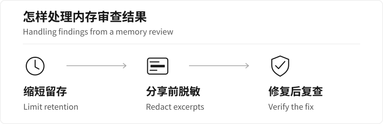

# Sensitive-Memory-Dump

[简体中文](README.md) · [English](README.en.md)

This tool helps review whether your own Windows or Android application retains sensitive text in process memory. A match describes one sample; interpreting it requires knowing when the application should have released the value.

Use synthetic values, note the field category and lifecycle stage, and redact the value before sharing a report. After a fix, check the same stage again.

[License](LICENSE)
