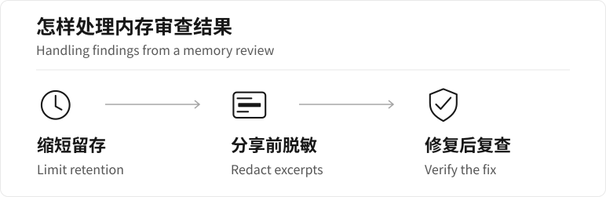

# Sensitive-Memory-Dump

[简体中文](README.md) · [English](README.en.md)

这个工具用于检查自己的 Windows 或 Android 应用是否在进程内存中保留敏感文本。一次命中只能说明采样时发现了匹配内容，需要结合应用的生命周期判断。

用虚构数据复现自己的应用状态，只记录字段类别和出现时机。分享报告时遮盖原值；修复后在相同生命周期节点复查。

[许可证](LICENSE)
